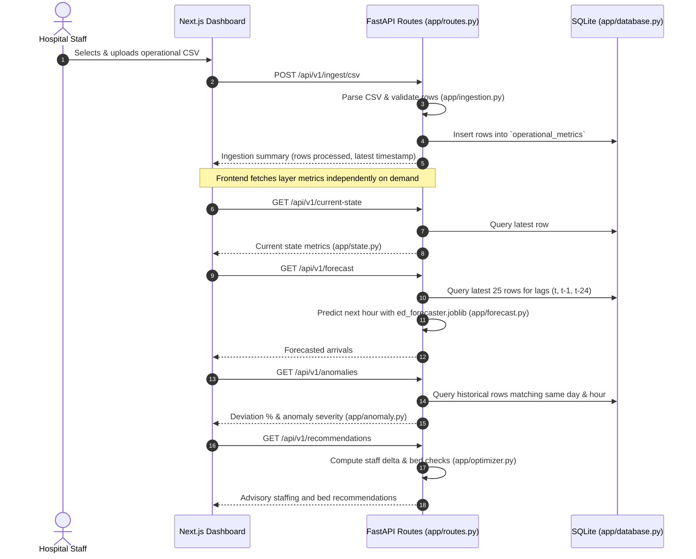

# System Architecture & Implementation Plan: AI-Based Hospital Operations Forecasting and Resource Optimization System

**Status:** PROVISIONAL (College Major Project Specification: Designed for viva explainability and minimal moving parts; resource optimization thresholds and staffing ratios are provisional placeholders).  
**Author:** Senior Software Architect  
**Target Repository:** `AI-Based-Hospital-Operations-Forecasting-and-Resource-Optimization-System`

---

## 1. Overview and Goals / Non-Goals

### 1.1 Purpose
A college major project demonstrating a decision-support and operational intelligence overlay that runs on top of existing hospital data without replacing Hospital Information Systems (HIS). The system demonstrates four core operational questions in a straightforward, explainable architecture:
1. *What is happening now?* (Layer 1: Current Hospital State)
2. *Is anything unusual?* (Layer 3: Anomaly Detection against hour-of-week baseline)
3. *What is likely to happen next?* (Layer 2: Next-Hour ED Arrival Forecasting)
4. *How should available resources be allocated?* (Layer 4: Rule-based Resource Optimization recommendations)

### 1.2 System Goals
- Ingest operational hourly time-series data via batch CSV upload.
- Store operational metrics in a single SQLite table via SQLAlchemy, configured through a single `DATABASE_URL` environment variable for zero-code PostgreSQL compatibility.
- Compute all four layer outputs **on-demand on request** when the frontend calls the respective GET endpoints.
- Keep machine learning and statistical models simple, explainable, and reproducible for demonstration in an academic viva:
  - Forecast model: simple regressor with hour, day-of-week, and 3 arrival lags ($t, t-1, t-24$).
  - Anomaly detector: percentage deviation against historical hour-of-week mean.
  - Resource optimizer: straightforward staffing ratio rules and bed threshold checks.
- Render results in a clean, responsive Next.js dashboard with a prominent clinical advisory banner.

### 1.3 Non-Goals (Explicitly Out of Scope)
- **Direct EHR / Patient Record Ingestion:** No unstructured chart parsing or patient-level data.
- **HIS Replacement & Autonomous Actuation:** Recommendations are strictly advisory; the system never executes staffing actions.
- **User Authentication / RBAC:** Single open intranet dashboard without login or roles.
- **Containerization / Docker:** Runs directly in local Python and Node.js environments.

---

## 2. Sources and Evidence

### 2.1 Analyzed Artifacts
1. **`README.md`:** Defines the 4 layers, sample operational row schema, and Next.js + FastAPI tech stack.
2. **`Hospital AI Workflow Architecture.png`:** Visual system flow covering ingestion, data store, 4 layers, API endpoints, and frontend presentation.
3. **Active Environment:** Python virtual environment (`.venv`) with FastAPI, Pydantic, Pandas, Scikit-learn, Scipy, Pytest, and Uvicorn.

### 2.2 Source Conflicts and Documented Resolutions
- **Conflict 1 (Database Engine):** Diagram states PostgreSQL. Deliberately substituted with SQLite for v1 via SQLAlchemy for zero-dependency local execution; standard ANSI SQL is maintained via `DATABASE_URL`.
- **Conflict 2 (Ingestion Mechanism):** Diagram mentions API & CSV. Explicitly narrowed to CSV multipart upload only (`POST /api/v1/ingest/csv`).

---

## 3. Requirements with IDs

### Functional Requirements

| ID | Requirement | Source | Priority | Acceptance Criteria |
| :--- | :--- | :--- | :--- | :--- |
| **REQ-001** | CSV Operational Data Ingestion | README §3, Diagram | Must | `POST /api/v1/ingest/csv` accepts a CSV file, validates required columns and positive integers, and appends valid rows to the database. Rejects invalid files with HTTP 422. |
| **REQ-002** | Schema Validation & Data Cleaning | Diagram Box 2 | Must | [PROVISIONAL: designed by architect, not from sources] Validates 7 required fields (`timestamp`, `ed_arrivals`, `ed_patients`, `available_beds`, `icu_occupancy_pct`, `nurses_available`, `doctors_available`). Enforces $0.0 \le \text{icu\_occupancy\_pct} \le 100.0$. |
| **REQ-003** | Persistent Database Storage | Diagram Box 2, User Directive | Must | Stores operational rows in a single `operational_metrics` table using SQLAlchemy. Tables are auto-created at startup via `Base.metadata.create_all(bind=engine)` using `DATABASE_URL`. |
| **REQ-004** | Layer 1: Current State Extraction | README §3, Diagram Box 3 | Must | `GET /api/v1/current-state` queries the latest row in the database and returns current metrics alongside patient-to-nurse and patient-to-doctor ratios. Returns HTTP 404 if database is empty. |
| **REQ-005** | Layer 2: Next-Hour ED Arrival Forecasting | README §4, Diagram Box 4 | Must | `GET /api/v1/forecast` loads `ed_forecaster.joblib` and predicts next-hour arrivals using the latest row, $t-1$, and $t-24$ lags. Returns HTTP 400 with a clear error message if model or lag data is missing. |
| **REQ-006** | Layer 3: Independent Anomaly Detection | README §5, Diagram Box 5 | Must | `GET /api/v1/anomalies` compares latest ED arrivals against the historical hour-of-week mean baseline; computes deviation percentage and assigns severity (`NORMAL`, `MODERATE_SURGE`, `CRITICAL_SURGE`, `MODERATE_DROP`, `UNUSUAL_DROP`). |
| **REQ-007** | Layer 4: Resource Allocation Optimization | README §6, Diagram Box 6 | Must | `GET /api/v1/recommendations` calculates staffing surplus/deficit against target ratios and checks the bed alert threshold, returning advisory recommendations. |
| **REQ-008** | Synthetic Data Generator Script | User Directive | Must | `scripts/generate_synthetic_data.py` generates a realistic multi-week operational CSV using a fixed random seed (`42`) with hourly and daily arrival patterns. |
| **REQ-009** | Re-runnable Model Training Script | User Directive | Must | `scripts/train_forecaster.py` trains a simple scikit-learn regressor on the synthetic CSV and serializes the model to `backend/models/ed_forecaster.joblib`. |
| **REQ-010** | Unified Frontend Dashboard | README §7, §9, Diagram | Must | Next.js (TypeScript, Tailwind CSS) displaying: (1) CSV file upload button, (2) Layer 1 state cards, (3) Layer 2 forecast card with 24-hour trend line, (4) Layer 3 anomaly card, and (5) Layer 4 recommendation list. |
| **REQ-011** | Human-in-the-Loop Advisory Notice | README §6, User Directive | Must | UI and API responses prominently display an advisory notice stating recommendations are decision-support outputs and require human clinical verification before execution. |

### Non-Functional Requirements (NFR)

| ID | Requirement | Source | Priority | Acceptance Criteria |
| :--- | :--- | :--- | :--- | :--- |
| **NFR-001** | Zero Cloud / Daemon Dependency | User Directive | Must | Runs locally on SQLite without Docker, external database servers, or background worker daemons. |
| **NFR-002** | Explainable Simplicity | Student Viva Requirement | Must | Every component, ML feature, and formula can be explained in 1–2 plain sentences during an academic defense. |
| **NFR-003** | Deterministic Reproducibility | User Directive | Must | Synthetic dataset generation and model training produce bit-exact identical weights given seed `42`. |
| **NFR-004** | PostgreSQL Portability | User Directive | Must | Standard SQLAlchemy models and ANSI SQL queries with no SQLite-only dialect features, configurable via `DATABASE_URL`. |

---

## 4. Assumptions and Open Questions

### 4.1 Assumptions
1. **Hourly Cadence:** Operational data represents consecutive hourly summaries (e.g. `2026-10-29 14:00:00`).
2. **Staffing Scope:** `nurses_available` and `doctors_available` represent **ED-only active staff on duty**. Redeployments indicate staff shifted from other hospital units into the ED.
3. **On-Demand Evaluation:** Each GET endpoint computes its response dynamically when requested by the frontend from `operational_metrics`.
4. **Provisional Constraints & Thresholds (`app/config.py`) [PROVISIONAL]:**
   - `TARGET_PATIENTS_PER_NURSE = 4.0` (1 nurse per 4 active ED patients).
   - `MAX_NURSES_REDEPLOYABLE = 4` (max 4 nurses shifted to ED per hour).
   - `FORECAST_WEIGHT = 0.5` (weight applied to forecasted net arrivals).
   - `MIN_AVAILABLE_BEDS_THRESHOLD = 50` (triggers bed alert when $\text{available\_beds} < 50$).
   - `ICU_OCCUPANCY_WARNING_PCT = 88.0` (triggers ICU alert when $\text{icu\_occupancy\_pct} \ge 88.0\%$).
   - `ANOMALY_CRITICAL_SURGE_PCT = 30.0` (deviation % threshold for critical surge).
   - `ANOMALY_MODERATE_SURGE_PCT = 15.0` (deviation % threshold for moderate surge).
   - `ANOMALY_MODERATE_DROP_PCT = -15.0` (deviation % threshold for moderate drop).
   - `ANOMALY_UNUSUAL_DROP_PCT = -30.0` (deviation % threshold for unusual drop).
5. **Input Schema [PROVISIONAL: designed by architect, not from sources]:** The 7-field operational schema (`timestamp`, `ed_arrivals`, `ed_patients`, `available_beds`, `icu_occupancy_pct`, `nurses_available`, `doctors_available`) is a provisional architect design based on README §3.

### 4.2 Open Questions (Non-Blocking)
- *OPQ-001:* Will the hospital eventually track distinct triage categories (e.g., ESI level 1–5)? *Resolution:* v1 tracks total ED arrivals and active patients.
- *OPQ-002:* Should historical data upload support appending vs. overwriting? *Resolution:* v1 enforces idempotent chronological upsert based on unique UTC `timestamp`.

---

## 5. Architecture

### 5.1 System Component Topology

```
+-----------------------------------------------------------------------------------------+
|                                    NEXT.JS FRONTEND                                     |
|  - CSV File Upload Component       - Layer 1 Current State Cards                        |
|  - Layer 2 Forecast Trend View    - Layer 3 Anomaly Status Alert                        |
|  - Layer 4 Optimization Recommendations (Advisory Banner)                               |
+----------------------------------------------------+------------------------------------+
                                                     | HTTP (JSON / multipart-form)
                                                     v
+----------------------------------------------------+------------------------------------+
|                         FASTAPI BACKEND API (app/routes.py)                             |
|  - POST /api/v1/ingest/csv  -> app/ingestion.py                                         |
|  - GET  /api/v1/current-state -> app/state.py                                           |
|  - GET  /api/v1/forecast     -> app/forecast.py                                         |
|  - GET  /api/v1/anomalies    -> app/anomaly.py                                          |
|  - GET  /api/v1/recommendations -> app/optimizer.py                                     |
+----------------------------------------------------+------------------------------------+
                                                     | Queries on demand
                                                     v
+----------------------------------------------------+------------------------------------+
|                         DATABASE (app/database.py)                                      |
|  - Single table: `operational_metrics`                                                  |
|  - Created at startup via SQLAlchemy `create_all`                                       |
|  - SQLite (v1 Default: `sqlite:///./hospital_operations.db`)                            |
+-----------------------------------------------------------------------------------------+
```

### 5.2 End-to-End Ingestion & Query Data Flow



---

## 6. Data Model and API Contracts

### 6.1 Database Schema (`app/database.py`)

A single table created at application startup with SQLAlchemy `Base.metadata.create_all`:

#### Table: `operational_metrics`
- `id` (Integer, Primary Key, autoincrement sequence)
- `timestamp` (DateTime, timezone=True, unique=True, index=True, nullable=False)
- `ed_arrivals` (Integer, nullable=False)
- `ed_patients` (Integer, nullable=False)
- `available_beds` (Integer, nullable=False)
- `icu_occupancy_pct` (Float, nullable=False)
- `nurses_available` (Integer, nullable=False) — *ED-only active nurses on duty*
- `doctors_available` (Integer, nullable=False) — *ED-only active doctors on duty*
- `created_at` (DateTime, timezone=True, default=utcnow)

---

### 6.2 API Contracts & Pydantic Schemas (`app/schemas.py`)

#### 1. Ingestion: `POST /api/v1/ingest/csv`
- **Request:** `multipart/form-data` with field `file` (`.csv`).
- **Response (HTTP 200):**
```json
{
  "status": "success",
  "filename": "hospital_ops.csv",
  "rows_processed": 168,
  "rows_updated": 0,
  "latest_timestamp": "2026-10-29T14:00:00Z"
}
```
- **Error (HTTP 422):** Returns structured validation error if required columns or ranges are invalid.

#### 2. Current State: `GET /api/v1/current-state`
- **Response (HTTP 200):**
```json
{
  "timestamp": "2026-10-29T14:00:00Z",
  "ed_arrivals": 57,
  "ed_patients": 46,
  "available_beds": 42,
  "icu_occupancy_pct": 87.0,
  "nurses_available": 10,
  "doctors_available": 4,
  "metrics": {
    "patient_to_nurse_ratio": 4.6,
    "patient_to_doctor_ratio": 11.5
  }
}
```

#### 3. Forecast: `GET /api/v1/forecast`
- **Response (HTTP 200):**
```json
{
  "target_timestamp": "2026-10-29T15:00:00Z",
  "current_ed_arrivals": 57,
  "predicted_ed_arrivals": 61.0,
  "expected_net_change": 4.0,
  "recent_arrivals": [
    {
      "timestamp": "2026-10-28T15:00:00Z",
      "arrivals": 42
    },
    {
      "timestamp": "2026-10-29T14:00:00Z",
      "arrivals": 57
    }
  ],
  "model_metadata": {
    "model_name": "HistGradientBoostingRegressor",
    "version": "1.0.0"
  }
}
```
- **Error (HTTP 400):** `"Model not trained. Run train_forecaster.py first"` or `"Insufficient lag data. Upload at least 25 hours of operational data."`

#### 4. Anomaly Detection: `GET /api/v1/anomalies`
- **Response (HTTP 200):**
```json
{
  "timestamp": "2026-10-29T14:00:00Z",
  "observed_value": 57,
  "expected_baseline": 40.0,
  "deviation_pct": 42.5,
  "is_anomaly": true,
  "severity": "CRITICAL_SURGE",
  "explanation": "ED arrivals (57) are 42.5% above the historical Thursday 14:00 baseline (40.0)."
}
```
*Severity values: `NORMAL`, `MODERATE_SURGE`, `CRITICAL_SURGE`, `MODERATE_DROP`, `UNUSUAL_DROP`.*
- **Error (HTTP 400):** `"Insufficient historical data to compute baseline for Thursday 14:00."`

#### 5. Resource Recommendations: `GET /api/v1/recommendations`
- **Response (HTTP 200):**
```json
{
  "timestamp": "2026-10-29T14:00:00Z",
  "advisory_disclaimer": "PROVISIONAL: Recommendations are advisory decision-support suggestions based on placeholder hospital constraints and require clinical verification.",
  "status_summary": "High ED demand surge forecasted; staffing adjustment recommended.",
  "recommendations": [
    {
      "id": "REC-001",
      "category": "STAFFING_NURSE",
      "priority": "HIGH",
      "action": "Consider allocating 2 additional nurses to the ED",
      "rationale": "Projected active load of 48 patients (46 active + 2 net forecasted surge; discharges excluded in v1) requires 12 nurses at 4.0 patients/nurse (current ED staffing: 10 nurses).",
      "constraints_checked": "Within max redeployment budget (4 nurses max). Assumes minimum inpatient floor coverage maintained."
    },
    {
      "id": "REC-002",
      "category": "BED_MANAGEMENT",
      "priority": "HIGH",
      "action": "Review inpatient bed turnover",
      "rationale": "Available beds (42) has fallen below the minimum threshold (50)."
    }
  ],
  "resource_state": {
    "projected_ed_patients": 48,
    "target_nurses_needed": 12,
    "current_nurses_allocated": 10,
    "nurse_deficit": 2
  }
}
```

---

## 7. Algorithms & Business Logic Design

### 7.1 Layer 2: ED Arrival Forecasting Model (`app/forecast.py`)
- **Objective:** Predict next-hour ED arrivals $\hat{y}_{t+1}$.
- **Features (5 simple features):**
  1. `hour_of_day` (0–23)
  2. `day_of_week` (0–6)
  3. $y_t$ (current ED arrivals)
  4. $y_{t-1}$ (ED arrivals 1 hour ago)
  5. $y_{t-24}$ (ED arrivals 24 hours ago)
- **Model:** `sklearn.ensemble.HistGradientBoostingRegressor` (or `Ridge`).
- **Failure Behavior:** If `backend/models/ed_forecaster.joblib` does not exist, return HTTP 400: `"Model not trained. Run train_forecaster.py first"`. If fewer than 25 continuous hours are in the database, return HTTP 400: `"Upload at least 25 hours of data to supply required lags."`

### 7.2 Layer 3: Anomaly Detection (`app/anomaly.py`)
- **Objective:** Detect unusual spikes or drops in current ED arrivals against the historical hour-of-week mean.
- **Baseline Computation:** Filter historical rows for matching `(day_of_week, hour_of_day)` excluding the current observation. Compute mean baseline $\mu_{d, h}$.
- **Formula:**
  $$\text{Deviation } \% = \frac{y_t - \mu_{d, h}}{\mu_{d, h}} \times 100\%$$
- **Classification Rules (using named thresholds from `app/config.py`):**
  - $\text{Deviation } \% \ge \text{ANOMALY\_CRITICAL\_SURGE\_PCT}$ ($+30.0\%$): `CRITICAL_SURGE` (`is_anomaly = True`)
  - $\text{ANOMALY\_MODERATE\_SURGE\_PCT} \le \text{Deviation } \% < \text{ANOMALY\_CRITICAL\_SURGE\_PCT}$: `MODERATE_SURGE` (`is_anomaly = True`)
  - $\text{ANOMALY\_MODERATE\_DROP\_PCT} < \text{Deviation } \% < \text{ANOMALY\_MODERATE\_SURGE\_PCT}$: `NORMAL` (`is_anomaly = False`)
  - $\text{ANOMALY\_UNUSUAL\_DROP\_PCT} < \text{Deviation } \% \le \text{ANOMALY\_MODERATE\_DROP\_PCT}$: `MODERATE_DROP` (`is_anomaly = True`)
  - $\text{Deviation } \% \le \text{ANOMALY\_UNUSUAL\_DROP\_PCT}$ ($-30.0\%$): `UNUSUAL_DROP` (`is_anomaly = True`)
- **Failure Behavior:** If historical sample count for the hour-of-week bin is 0 or if the baseline mean $\mu_{d, h} = 0$, return HTTP 400: `"Insufficient historical data to compute baseline for this time period."`

### 7.3 Layer 4: Resource Optimization (`app/optimizer.py`) [PROVISIONAL]
- **Formulas:**
  1. *Projected ED Active Load ($L_{\text{proj}}$):*
     $$L_{\text{proj}} = \text{ed\_patients}_t + \max(0, \lceil w_{\text{fc}} \cdot (\hat{y}_{t+1} - y_t) \rceil)$$
     *(Estimated discharges excluded in v1: $\text{est\_discharges} = 0$. With active $= 46$, $y_t = 57$, $\hat{y}_{t+1} = 61.0$, $w_{\text{fc}} = 0.5 \implies 46 + \lceil 0.5 \times 4.0 \rceil = 48$)*.
  2. *Required Staffing:*
     $$N_{\text{req}} = \left\lceil \frac{L_{\text{proj}}}{\text{TARGET\_PATIENTS\_PER\_NURSE}} \right\rceil = \left\lceil \frac{48}{4.0} \right\rceil = 12$$
  3. *Staffing Delta:*
     $$\Delta N = \min(\max(N_{\text{req}} - N_{\text{current}}, 0), \text{MAX\_NURSES\_REDEPLOYABLE}) = \min(12 - 10, 4) = 2$$
  4. *Bed & ICU Warning:*
     If $\text{available\_beds} < \text{MIN\_AVAILABLE\_BEDS\_THRESHOLD}$ ($42 < 50$ [PROVISIONAL]) or $\text{icu\_occupancy\_pct} \ge \text{ICU\_OCCUPANCY\_WARNING\_PCT}$ ($\ge 88.0\%$ [PROVISIONAL]), trigger bed buffer review recommendation.
     *Rationale Construction Rule:* The recommendation's rationale must state only the specific condition(s) that actually fired, e.g. "Available beds (42) below minimum threshold (50)" and/or "ICU occupancy (91%) at or above warning level (88%)". Never mention a condition that did not fire.

---

## 8. UI Specification (Next.js + Tailwind CSS)

### 8.1 Page Layout (`/` Single Page Dashboard)
- **Top Navigation Bar:**
  - System Title: `Hospital Operations Intelligence & Forecasting`
  - Advisory Badge: `Advisory Decision Support System - Not an Autonomous Actuator` (Yellow/Slate badge)
  - Last Ingested Timestamp Display + Ingestion Modal Button
- **Section 1: Ingestion Banner & Dropzone Modal (`components/IngestionModal.tsx`):**
  - File picker accepting `.csv` files.
- **Section 2: Layer 1 — Current Hospital State (`components/CurrentStateCards.tsx`):**
  - Card A: ED Arrivals (`57`) & Active ED Patients (`46`).
  - Card B: Available Beds (`42 available`, amber warning if $< 50$).
  - Card C: ICU Occupancy (`87.0%`, red critical badge if $\ge 88.0\%$).
  - Card D: ED Staff on Duty (`10 Nurses`, `4 Doctors`).
- **Section 3: Layer 2 & 3 — Predictive Intelligence (Two-Column Grid):**
  - **Left (`components/ForecastCard.tsx`):**
    - Large KPI: Expected Next-Hour Arrivals (`61.0`).
    - Net Change: `+4.0 from current (57)`.
    - Historical trend line chart (last 24 hours observed vs. next hour forecasted) using Recharts.
  - **Right (`components/AnomalyCard.tsx`):**
    - Status Badge renders one of 5 severity states:
      - `CRITICAL_SURGE` (Red alert)
      - `MODERATE_SURGE` (Amber alert)
      - `NORMAL` (Green standard badge)
      - `MODERATE_DROP` (Blue alert)
      - `UNUSUAL_DROP` (Indigo alert)
    - Comparative Metric: `+42.5% vs. Thursday 14:00 baseline (40.0)`.
- **Section 4: Layer 4 — Recommended Actions (`components/RecommendationList.tsx`):**
  - Cards rendering recommended actions, rationale, and constraints checked.
  - Disclaimer text beneath each action: *"Requires supervisor sign-off before floor adjustment."*

---

## 9. Security, Privacy, and Error Handling

- **Privacy:** Aggregate hourly operational statistics only; zero patient names, MRNs, or PII.
- **Explicit Error Handling:**
  - Missing model file $\to$ HTTP 400: `"Model not trained. Run train_forecaster.py first"`.
  - Missing lag data ($< 25\text{h}$) $\to$ HTTP 400: `"Upload at least 25 hours of data to compute lags"`.
  - Empty database table $\to$ HTTP 404: `"No operational data available"`.

---

## 10. Full Folder Tree

```
AI-Based-Hospital-Operations-Forecasting-and-Resource-Optimization-System/
├── .gitignore
├── Hospital AI Workflow Architecture.png
├── README.md
├── plan.md
├── backend/
│   ├── .env.example                            # DATABASE_URL=sqlite:///./hospital_operations.db
│   ├── pyproject.toml                          # Python metadata and tool configurations
│   ├── requirements.txt                        # Pinned dependencies
│   ├── app/
│   │   ├── main.py                             # FastAPI app factory, CORS, table initialization
│   │   ├── config.py                           # Settings and PROVISIONAL constraints/thresholds
│   │   ├── database.py                         # SQLAlchemy engine, session, and OperationalMetrics model
│   │   ├── schemas.py                          # All Pydantic request/response DTOs
│   │   ├── ingestion.py                        # CSV parsing, validation, and database insert logic
│   │   ├── state.py                            # Layer 1 current state computation
│   │   ├── forecast.py                         # Layer 2 model inference logic
│   │   ├── anomaly.py                          # Layer 3 hour-of-week baseline & deviation logic
│   │   ├── optimizer.py                        # Layer 4 rule-based advisory recommendation engine
│   │   └── routes.py                           # All 5 API endpoint definitions
│   ├── models/
│   │   └── .gitkeep                            # Placeholder for ed_forecaster.joblib (gitignored)
│   ├── scripts/
│   │   ├── generate_synthetic_data.py          # Deterministic synthetic data generator script
│   │   └── train_forecaster.py                 # Re-runnable model training script
│   └── tests/
│       ├── conftest.py                         # Test fixtures & test database setup
│       ├── test_ingest.py                      # CSV validation and parsing unit tests
│       ├── test_layers.py                      # Tests for Layer 1, 2, 3, and 4 logic
│       └── test_api.py                         # Integration tests for all 5 HTTP endpoints
└── frontend/
    ├── .env.example                            # NEXT_PUBLIC_API_BASE_URL=http://localhost:8000
    ├── .env.local                              # Local environment variables
    ├── package.json                            # Next.js 16, React 19, Tailwind CSS v4, Lucide, Recharts
    ├── tsconfig.json                           # TypeScript configuration with @/* path alias
    ├── next.config.ts                          # Next.js configuration
    ├── eslint.config.mjs                       # ESLint configuration
    └── src/
        ├── app/
        │   ├── layout.tsx                      # Root layout with Chivo & Atkinson fonts & advisory banner
        │   ├── page.tsx                        # Main operational dashboard page
        │   └── globals.css                     # Tailwind CSS v4 imports & clinical theme tokens
        ├── components/
        │   ├── Navbar.tsx                      # Top bar with title & upload button
        │   ├── IngestionModal.tsx              # CSV upload modal
        │   ├── CurrentStateStrip.tsx           # Clinical vitals telemetry strip
        │   ├── ForecastCard.tsx                # Next-hour arrival forecast & 24h trajectory chart
        │   ├── AnomalySign.tsx                 # Hospital wayfinding sign with triage severity
        │   └── RecommendationList.tsx          # Prioritized decision-support action queue
        └── lib/
            ├── api.ts                          # Fetch client configured via NEXT_PUBLIC_API_BASE_URL
            ├── formatters.ts                   # UTC date/time and category name formatters
            └── types.ts                        # TypeScript interfaces matching backend DTOs
```

---

## 11. File-by-File Specifications

### 11.1 Backend Core Application Files
- `backend/app/main.py`: Creates FastAPI application, configures CORS middleware, mounts routes from `app/routes.py`, and initializes database tables on startup via `Base.metadata.create_all(bind=engine)`.
- `backend/app/config.py`: Reads `DATABASE_URL` and `CORS_ORIGINS`, and defines all provisional placeholder constraints, anomaly thresholds, and the advisory notice (`TARGET_PATIENTS_PER_NURSE = 4.0`, `MAX_NURSES_REDEPLOYABLE = 4`, `FORECAST_WEIGHT = 0.5`, `MIN_AVAILABLE_BEDS_THRESHOLD = 50`, `ICU_OCCUPANCY_WARNING_PCT = 88.0`, `ANOMALY_CRITICAL_SURGE_PCT = 30.0`, `ANOMALY_MODERATE_SURGE_PCT = 15.0`, `ANOMALY_MODERATE_DROP_PCT = -15.0`, `ANOMALY_UNUSUAL_DROP_PCT = -30.0`, `ADVISORY_DISCLAIMER`).
- `backend/app/database.py`: Sets up SQLAlchemy `engine`, `SessionLocal`, base declarative class `Base`, and the `OperationalMetrics` table model.
- `backend/app/schemas.py`: Contains all Pydantic schemas: `OperationalRowSchema`, `IngestionResponse`, `CurrentStateResponse`, `ForecastResponse` (including `HourlyArrival` and `recent_arrivals`), `AnomalyResponse`, and `RecommendationResponse`.
- `backend/app/ingestion.py`: Reads raw CSV files with Pandas, validates columns and positive ranges, converts timestamps to UTC, and performs idempotent upsert into SQLite.
- `backend/app/state.py`: Implements Layer 1 by fetching the latest row from `operational_metrics` and calculating patient-to-nurse and patient-to-doctor ratios.
- `backend/app/forecast.py`: Implements Layer 2 by verifying `ed_forecaster.joblib` exists, fetching the latest 25 rows for lags ($t, t-1, t-24$), returning the last 24 observed hourly arrivals (`recent_arrivals`, oldest first), and predicting next-hour arrivals.
- `backend/app/anomaly.py`: Implements Layer 3 by computing the historical mean baseline for the matching hour-of-week and classifying deviation percentage into 5 severity categories using named thresholds from `app/config.py`.
- `backend/app/optimizer.py`: Implements Layer 4 by evaluating required nurse counts against target ratios, calculating staffing deltas capped at redeployment limits, and checking bed/ICU thresholds.
- `backend/app/routes.py`: Defines the 5 endpoints (`POST /api/v1/ingest/csv`, `GET /api/v1/current-state`, `GET /api/v1/forecast`, `GET /api/v1/anomalies`, `GET /api/v1/recommendations`).

### 11.2 Backend Scripts & Artifacts
- `backend/scripts/generate_synthetic_data.py`: Standalone script generating realistic operational hourly CSVs using seed `42`.
- `backend/scripts/train_forecaster.py`: Standalone script extracting lags ($t, t-1, t-24$) and calendar features, training `HistGradientBoostingRegressor`, and saving `backend/models/ed_forecaster.joblib`.
- `backend/models/.gitkeep`: Preserves directory in git; `ed_forecaster.joblib` is generated by `train_forecaster.py` and ignored by `.gitignore`.

### 11.3 Backend Test Suite
- `backend/tests/conftest.py`: Pytest fixtures creating a temporary SQLite test database and sample operational records.
- `backend/tests/test_ingest.py`: Tests for CSV ingestion, schema validation, range checks, and malformed file rejections.
- `backend/tests/test_layers.py`: Unit tests for Layer 1 state calculations, Layer 2 lag extraction & inference (including `recent_arrivals`), Layer 3 anomaly classifications (including zero-baseline HTTP 400 handling), and Layer 4 optimization rules.
- `backend/tests/test_api.py`: End-to-end integration tests verifying all 5 endpoints using FastAPI's `TestClient`.

### 11.4 Backend Config & Environment Files
- `backend/.env.example`: Declares default environment variables (`DATABASE_URL=sqlite:///./hospital_operations.db`).
- `backend/pyproject.toml`: Project configuration and pytest settings.
- `backend/requirements.txt`: Minimal pinned dependencies (`fastapi`, `uvicorn`, `sqlalchemy`, `pydantic`, `pandas`, `scikit-learn`, `joblib`, `pytest`, `httpx`).

### 11.5 Frontend Application Files
- `frontend/.env.example`: Declares `NEXT_PUBLIC_API_BASE_URL=http://localhost:8000`.
- `frontend/.env.local`: Local environment variable override.
- `frontend/package.json`: Frontend package manifest with Next.js 16, React 19, Tailwind CSS v4, Lucide icons, and Recharts.
- `frontend/tsconfig.json`: TypeScript configuration with `@/*` path alias.
- `frontend/next.config.ts`: Next.js TypeScript configuration.
- `frontend/eslint.config.mjs`: ESLint flat configuration.
- `frontend/src/app/globals.css`: Tailwind CSS v4 imports and clinical light theme tokens (`#F3F6F4` canvas, `#122B32` ink, `#0A6E73` signage teal, accessible triage colors).
- `frontend/src/app/layout.tsx`: Root layout with self-hosted Chivo and Atkinson Hyperlegible fonts and persistent advisory header banner.
- `frontend/src/app/page.tsx`: Main dashboard page coordinating data fetching across the 4 layers with isolated error resilience.
- `frontend/src/components/Navbar.tsx`: Header bar displaying project title, formatted UTC timestamp, and ingestion modal trigger.
- `frontend/src/components/IngestionModal.tsx`: Modal dialog for uploading operational CSV files with inserted/updated feedback.
- `frontend/src/components/CurrentStateStrip.tsx`: Clinical vitals telemetry strip displaying arrivals, patients, beds, ICU occupancy, and staff ratios.
- `frontend/src/components/ForecastCard.tsx`: Next-hour arrival forecast KPI and Recharts 24-hour historical trajectory with projected step.
- `frontend/src/components/AnomalySign.tsx`: Hospital wayfinding sign with triage severity (normal, surge, drop) and clinical explanation.
- `frontend/src/components/RecommendationList.tsx`: Prioritized decision-support action queue and resource state summary.
- `frontend/src/lib/api.ts`: Fetch client communicating with backend endpoints.
- `frontend/src/lib/formatters.ts`: UTC date/time and category name formatting utilities.
- `frontend/src/lib/types.ts`: TypeScript interfaces matching backend response schemas.

### 11.6 Root Repository Files
- `.gitignore`: Standard git ignore file (Python caches, virtual environments, node_modules, `*.joblib`).
- `README.md`: High-level project summary and layer descriptions.
- `Hospital AI Workflow Architecture.png`: Visual workflow architecture diagram.
- `plan.md`: This architecture specification.

---

## 12. Implementation Milestones

### Milestone 1: Database Setup, Synthetic Data & Model Training Script [COMPLETE]
- **Prerequisites:** Python virtual environment `.venv`.
- **Components Created:** `backend/app/config.py`, `backend/app/database.py`, `backend/scripts/generate_synthetic_data.py`, `backend/scripts/train_forecaster.py`.
- **Tests Written:** `backend/tests/conftest.py`, `backend/tests/test_layers.py`.
- **Done When:** Running `generate_synthetic_data.py` outputs a synthetic CSV, running `train_forecaster.py` creates `backend/models/ed_forecaster.joblib`, and tables are initialized in SQLite.

### Milestone 2: Data Ingestion & Layer 1 (Current State) [COMPLETE]
- **Prerequisites:** Milestone 1 complete.
- **Components Created:** `backend/app/schemas.py`, `backend/app/ingestion.py`, `backend/app/state.py`, `backend/app/routes.py` (ingest & current-state routes).
- **Tests Written:** `backend/tests/test_ingest.py`.
- **Done When:** Uploading a CSV via `POST /api/v1/ingest/csv` saves rows to SQLite, and `GET /api/v1/current-state` returns the latest operational metrics.

### Milestone 3: Predictive Intelligence (Layer 2 Forecast & Layer 3 Anomaly) [COMPLETE]
- **Prerequisites:** Milestone 2 complete.
- **Components Created:** `backend/app/forecast.py`, `backend/app/anomaly.py`, `backend/app/routes.py` (forecast & anomaly routes).
- **Tests Written:** Unit tests in `backend/tests/test_layers.py`.
- **Done When:** `GET /api/v1/forecast` returns next-hour predictions using lags, and `GET /api/v1/anomalies` correctly flags simulated arrival surges against the hour-of-week mean.

### Milestone 4: Resource Optimization (Layer 4) & Integration Tests [COMPLETE]
- **Prerequisites:** Milestone 3 complete.
- **Components Created:** `backend/app/optimizer.py`, `backend/app/routes.py` (recommendations route).
- **Tests Written:** `backend/tests/test_api.py`.
- **Done When:** `GET /api/v1/recommendations` outputs advisory staffing and bed adjustments, and all backend tests pass via `pytest`.

### Milestone 5: Frontend Dashboard [COMPLETE]
- **Prerequisites:** Milestone 4 complete.
- **Components Created:** Next.js scaffold in `frontend/`, all UI components, and API client.
- **Done When:** Running `npm run dev` serves the dashboard, allowing CSV upload and displaying live metrics for all four layers.

---

## 13. Test Strategy and Requirement-to-Test Traceability

| Requirement ID | Test Identifier | Test Location | Test Method & Assertion |
| :--- | :--- | :--- | :--- |
| **REQ-001** | `test_csv_ingest_success_and_malformed` | `tests/test_ingest.py` | Upload valid CSV $\to$ 200; upload corrupted/non-CSV file $\to$ 422 error. |
| **REQ-002** | `test_schema_validation_ranges` | `tests/test_ingest.py` | Verify negative arrivals or ICU occupancy $> 100\%$ are rejected with clear diagnostics. |
| **REQ-003** | `test_database_initialization` | `tests/test_layers.py` | Verify `Base.metadata.create_all` initializes SQLite table and allows inserts/queries. |
| **REQ-004** | `test_layer_1_current_state` | `tests/test_layers.py` | Ingest known record; assert `GET /current-state` matches input fields and computes load ratios. |
| **REQ-005** | `test_layer_2_forecast_inference` | `tests/test_layers.py` | Assert `predicted_ed_arrivals` is a valid positive float and lags $t, t-1, t-24$ are extracted. |
| **REQ-006** | `test_layer_3_anomaly_detection` | `tests/test_layers.py` | Feed baseline mean $\to$ assert `NORMAL`; feed $2\times$ baseline $\to$ assert `CRITICAL_SURGE`; feed drop $\to$ assert `UNUSUAL_DROP`; feed zero baseline $\to$ assert HTTP 400 error. |
| **REQ-007** | `test_layer_4_optimization_bounds` | `tests/test_layers.py` | Assert nurse redeployment recommendation never exceeds `MAX_NURSES_REDEPLOYABLE` (4). |
| **REQ-008** | `test_synthetic_data_generation` | `tests/test_layers.py` | Verify generator outputs non-empty CSV with all 7 columns. |
| **REQ-009** | `test_model_training_artifact` | `tests/test_layers.py` | Verify `train_forecaster.py` creates loadable `.joblib` model artifact. |
| **REQ-010** | `manual_dashboard_verification` | `frontend / browser` | Manual verification: Upload CSV via modal and confirm all four layer cards and the persistent clinical advisory banner render properly. |
| **REQ-011** | `test_advisory_disclaimer_presence` | `tests/test_api.py` | Assert `GET /recommendations` response includes mandatory advisory disclaimer string. |

---

## 14. Risks and Mitigations

| Risk Description | Severity | Probability | Mitigation Strategy |
| :--- | :--- | :--- | :--- |
| **Model Artifact Not Found:** User launches backend without running training script. | Low | Medium | `forecast.py` returns a clear HTTP 400 error explaining: *"Model not trained. Run train_forecaster.py first"*. |
| **Insufficient Historical Data:** User uploads CSV with fewer than 25 rows. | Low | Medium | `forecast.py` returns a clear HTTP 400 error explaining: *"Upload at least 25 hours of data to supply required lags"*. |
| **Clinical Misinterpretation:** Advisory recommendations mistaken for automated action. | High | Low | Prominent persistent yellow advisory disclaimer in the frontend header and inside API recommendation payloads. |

---

## 15. Deferred Decisions

1. **DEF-001 (Automated Retraining Orchestration):** Continuous online learning or scheduled cron retraining is deferred; manual re-runnable training script `train_forecaster.py` satisfies v1 requirements.

---

## 16. Readiness Checklist

- [x] Every source input (`README.md`, `Hospital AI Workflow Architecture.png`, commit history, active `.venv`) read and inspected.
- [x] Every requirement has a distinct tracking ID, source reference, priority, and testable acceptance criteria.
- [x] Source conflicts (PostgreSQL vs SQLite, CSV vs API ingestion) clearly documented and reconciled.
- [x] Every file in the folder tree has an explicit architectural specification in Section 11 and a milestone assignment.
- [x] Milestones are strictly ordered by dependency.
- [x] All blocking questions resolved; provisional placeholders clearly flagged and isolated in `app/config.py`.
- [x] No application code, scaffold, or packages written during this planning phase.

**Architect Status:** **PROVISIONAL** (Pending implementation and verification of simplified academic architecture).
